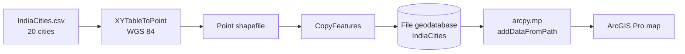
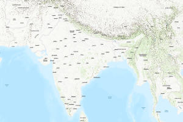

<div align="center">

# ArcPy Geoprocessing Portfolio

### Automating spatial data workflows with Python in ArcGIS Pro

[](https://www.esri.com/en-us/arcgis/products/arcgis-pro/overview)
[](https://pro.arcgis.com/en/pro-app/latest/arcpy/get-started/what-is-arcpy-.htm)
[](https://www.python.org/)
[](https://github.com/GraceMercyJoy)

A hands-on collection of ArcPy projects covering the geoprocessing lifecycle: authoring custom Python Toolboxes, creating and managing geodatabases, converting tabular data into spatial layers, and building validation-friendly tools that behave like native ArcGIS Pro tools.

</div>

---

## Overview

This repository contains four working ArcPy projects, each stored as a self-contained ArcGIS Pro assignment with its project file (`.aprx`), file geodatabase, input data, and Python source. The focus is not just on calling geoprocessing tools, but on designing reusable interfaces: typed parameters, field-aware SQL expressions, field mappings, parameter dependencies, custom validation, and clean error handling.

| Project | What it does | Core ArcPy APIs |
|---|---|---|
| **01 · Custom Buffer Tool** | Python Toolbox that buffers any input feature class; includes an exported ModelBuilder workflow | `arcpy.analysis.Buffer`, `arcpy.Parameter`, `arcpy.EnvManager` |
| **02 · Spatial Data Creation** | Builds feature datasets and feature classes, converts a CSV to points, copies data into a geodatabase, and adds the layer to a map | `CreateFeatureDataset`, `CreateFeatureclass`, `XYTableToPoint`, `CopyFeatures`, `arcpy.mp` |
| **04 · SQL Parameter Tool** | Custom tool with linked feature class, string, and SQL expression parameters | `DEFeatureClass`, `GPSQLExpression`, `parameterDependencies` |
| **05 · Append with Field Mapping** | Production-style append tool with toggles, point-only filtering, field mapping, and validation | `GPBoolean`, `GPFieldMapping`, `arcpy.management.Append`, `setErrorMessage` |

> `Assignment_03/` contains the shared input workspace (CSV and file geodatabase) used for data-access exercises.

---

## Why This Project Matters

Spatial data work often breaks down at the handoff between analysis and repeatable tooling. These projects demonstrate how to take a one-off workflow and turn it into a tool that another analyst can run safely:

- **Less room for user error** through typed parameters, filters, and required-field validation.
- **Reusable workflows** packaged as `.pyt` toolboxes instead of copy-pasted scripts.
- **Transparent execution** with geoprocessing messages and error handling.
- **Data integrity** maintained through geodatabases, coordinate systems, and field mappings.

---

## Projects in Detail

### 01 · Custom Buffer Tool

A Python Toolbox (`Buffertool.pyt`) that exposes a complete tool interface for buffering features:

- Input feature layer (`GPFeatureLayer`)
- Buffer distance (`GPString`)
- Output feature class (`DEFeatureClass`)
- Success message written to the geoprocessing history

```python
arcpy.analysis.Buffer(
    in_features=parameters[0].valueAsText,
    out_feature_class=parameters[2].valueAsText,
    buffer_distance_or_field=parameters[1].valueAsText
)

arcpy.AddMessage("Buffer created successfully")
```

The folder also includes `Modelbuilder.py.py`, an ArcPy export of a ModelBuilder workflow that exports an admin boundary shapefile into a file geodatabase table with an explicit field mapping and environment workspaces.

**Skills:** Python Toolbox structure, tool parameters, geoprocessing execution, ModelBuilder-to-Python export, environment management.

---

### 02 · Spatial Data Creation & Map Automation

This project builds a spatial dataset from scratch and automates the map side of ArcGIS Pro.



**What the scripts do**

- Create a feature dataset in a file geodatabase (WGS 84 / EPSG:4326).
- Create a polyline feature class at the geodatabase root and a point feature class inside the feature dataset.
- Convert `IndiaCities.csv` (20 city records with `Lat`/`Lon`) into a point shapefile using `XYTableToPoint`.
- Copy the shapefile into the geodatabase as a permanent feature class.
- Add the finished layer to the active map with `arcpy.mp.ArcGISProject("CURRENT")`.

```python
arcpy.management.XYTableToPoint(
    in_table=csv_file,
    out_feature_class=output_shp,
    x_field="Lon",
    y_field="Lat",
    coordinate_system=sr
)

arcpy.management.CopyFeatures(
    in_features=input_shp,
    out_feature_class=output_fc
)
```

**Skills:** geodatabase design, feature datasets, coordinate systems, CSV-to-geometry conversion, project and map automation.

---

### 04 · SQL Parameter Tool

`Assignment_4.pyt` demonstrates advanced tool parameter design. The tool accepts:

- a feature class,
- a free-text string,
- a SQL expression helper tied directly to the selected feature class.

The key pattern is parameter dependency: the SQL expression automatically inherits the schema of the chosen feature class, so users pick from real fields instead of typing invalid field names.

```python
param2.parameterDependencies = [param0.name]
```

Execution echoes the validated inputs into the tool messages, making the tool easy to verify and debug.

**Skills:** parameter types, parameter dependencies, SQL expression helpers, user-facing tool messages.

---

### 05 · Append with Field Mapping

`Assignment_05.pyt` is the most complete tool in the repository and models how a native ArcGIS Pro tool is designed.

<div align="center">

<br>
<em>India city points used to exercise the append and field-mapping workflow.</em>
</div>

**Tool behavior**

- Enable or disable the target layer with a `GPBoolean` toggle.
- Enable or disable the input layer with a second toggle.
- Restrict the input to point feature classes only (`filter.list = ["Point"]`).
- Expose a `GPFieldMapping` parameter whose schema is bound to the target layer.
- Raise an error when the target layer is enabled but empty.
- Raise a warning when the input layer toggle is on but no layer is selected.
- Append with `schema_type="NO_TEST"` so the supplied field mapping is respected.

```python
arcpy.management.Append(
    inputs=input_layer,
    target=target_layer,
    schema_type="NO_TEST",
    field_mapping=field_mapping
)
```

```python
if parameters[1].enabled and not parameters[1].value:
    parameters[1].setErrorMessage(
        "Target Layer is required when selection is enabled."
    )
```

A test run appended 7 features from `P2.shp` into `India_Cities_P1.shp`, confirmed in the geoprocessing history.

**Skills:** field mapping, dynamic parameter enabling, custom validation, point-geometry filters, exception handling with `arcpy.ExecuteError`.

---

## Engineering Highlights

| Area | Implementation |
|---|---|
| **Tool design** | Custom `.pyt` toolboxes with labels, aliases, descriptions, and native-style parameters |
| **Validation** | Required-field errors and non-blocking warnings via `updateMessages` |
| **Parameter UX** | Checkbox-driven enabling/disabling of downstream parameters |
| **Schema awareness** | SQL expressions and field maps linked to selected feature classes |
| **Error handling** | `try/except arcpy.ExecuteError` with messages written to GP history |
| **Data management** | File geodatabases, feature datasets, shapefiles, CSV inputs, WGS 84 |
| **Map automation** | Adding data to the active map through `arcpy.mp` |
| **Interoperability** | ModelBuilder workflows exported to maintainable Python |

---

## Technical Skills Demonstrated

**Geoprocessing**
`Buffer` · `Append` · `CopyFeatures` · `XYTableToPoint` · `ExportTable` · `CreateFeatureDataset` · `CreateFeatureclass`

**Toolbox development**
Python Toolboxes (`.pyt`) · `arcpy.Parameter` · datatypes (`GPFeatureLayer`, `DEFeatureClass`, `GPString`, `GPBoolean`, `GPSQLExpression`, `GPFieldMapping`) · `parameterDependencies` · `updateParameters` · `updateMessages` · `isLicensed` · `execute`

**Data & automation**
File geodatabases · feature datasets · coordinate systems · field mapping · `arcpy.mp` map automation · `arcpy.EnvManager` · geoprocessing messages

**Engineering**
Custom validation · error handling · reusable tool interfaces · ModelBuilder · documentation

---

## Repository Structure

```text
Arcgis_projects/
├── Assignment_01 - Arcpy daily task/
│   └── Buffertool_GraceMercy.zip/
│       ├── Buffertool.pyt              # Custom buffer Python Toolbox
│       ├── Modelbuilder.py.py          # Exported ModelBuilder workflow
│       └── Buffertool.shp / .dbf / ... # Buffer output data
├── Assignment_02/
│   ├── DataCreation.py                 # Create feature dataset + feature classes
│   └── DataCreation/
│       ├── DataCreation.aprx           # ArcGIS Pro project
│       ├── Data_creation.py            # CSV -> points -> GDB -> map
│       └── Input/IndiaCities.csv       # 20 cities with Lat/Lon
├── Assignment_03/
│   ├── DataAccess.py                   # Data-access workspace
│   └── Input/                          # Shared CSV + geodatabase
├── Assignment_04/
│   ├── Assignment_4.pyt                # SQL parameter tool
│   ├── Assignment_04.aprx
│   └── Input/Append/                   # P1 and P2 point layers
├── Assignment_05/
│   ├── Assignment_05.pyt               # Append with field mapping
│   ├── Assignment_05.aprx
│   └── Assignment_05.gdb
├── docs/images/                        # README preview assets
├── Assignment_04.zip                   # Original assignment archives
└── Assignment_05.zip
```

---

## Getting Started

### Requirements

- ArcGIS Pro 3.x (includes ArcPy and Python 3.13)
- A file geodatabase workspace (included in each assignment)
- No third-party Python packages required

### Run a tool

```bash
git clone https://github.com/GraceMercyJoy/Arcgis_projects.git
```

1. Open the relevant `.aprx` file in ArcGIS Pro.
2. In the Catalog pane, expand **Toolboxes** and add the assignment's `.pyt` file.
3. Open the tool, set the parameters, and run it.
4. Review messages in the **Geoprocessing** pane and results in the map.

### Run a script

Open the assignment's `.py` file in the ArcGIS Pro Python window or run it with the ArcGIS Pro Python environment. Update the hard-coded workspace paths at the top of each script to match your local machine before running.

```python
gdb = r"C:\path\to\your\project.gdb"
arcpy.env.workspace = gdb
arcpy.env.overwriteOutput = True
```

> Paths in the original coursework point to a local ArcGIS Pro project directory. This is expected for assignment archives; change them to your own workspace when reusing the code.

---

## Data

- **IndiaCities.csv** — 20 major Indian cities with latitude and longitude in WGS 84. Used to demonstrate tabular-to-spatial conversion.
- **India_Cities_P1 / P2** — Point feature classes used to test append behavior and field mapping.
- **Admin boundary** — Polygon layer exported from ModelBuilder to a geodatabase table.
- All datasets are used for learning and demonstration purposes.

---

## Key Takeaways

- A geoprocessing script becomes genuinely reusable when its inputs are typed, validated, and self-documenting.
- Parameter dependencies are what make custom tools feel native: SQL expressions and field maps should follow the selected dataset.
- Good tools fail loudly and helpfully. Errors belong in the tool's validation layer, not in a silent `except` block.
- Packaging work as a `.pyt` toolbox and a documented ArcGIS Pro project makes it far easier for another analyst to reproduce.

---

## Author

**Grace Mercy Joy**

Built and maintained as a geospatial automation portfolio.

- GitHub: [github.com/GraceMercyJoy](https://github.com/GraceMercyJoy)
- Repository: [github.com/GraceMercyJoy/Arcgis_projects](https://github.com/GraceMercyJoy/Arcgis_projects)

---

<div align="center">
<sub>ArcGIS Pro · ArcPy · Python · Geodatabase Automation</sub>
</div>
